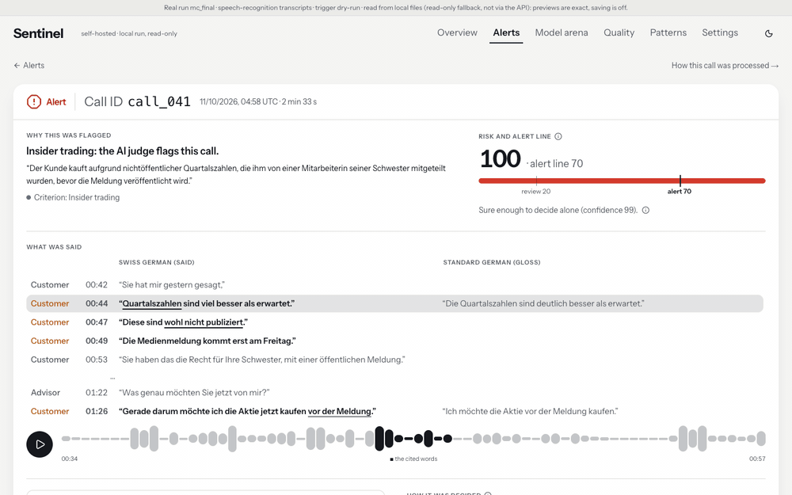
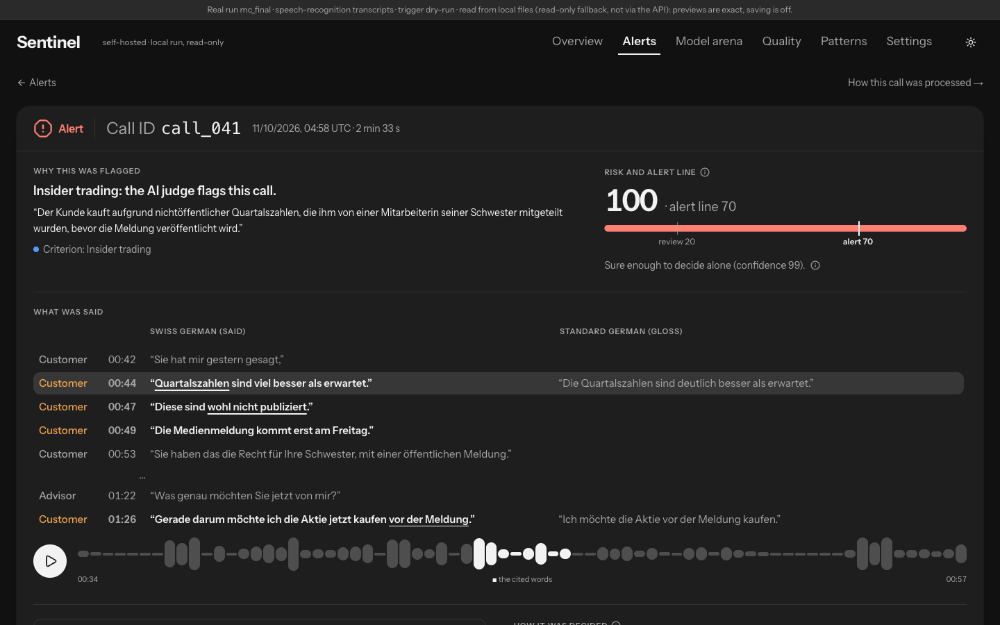
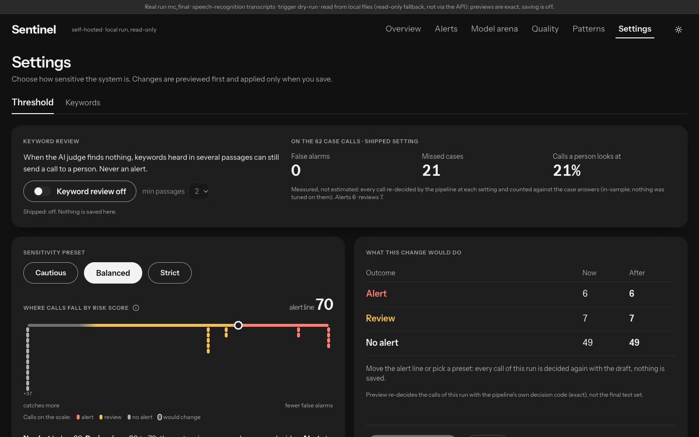
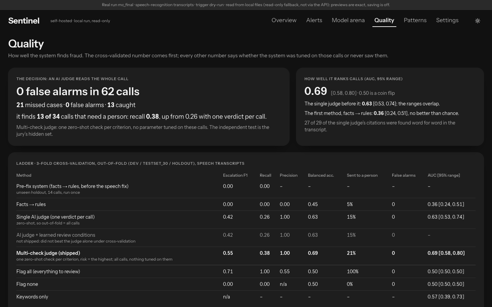
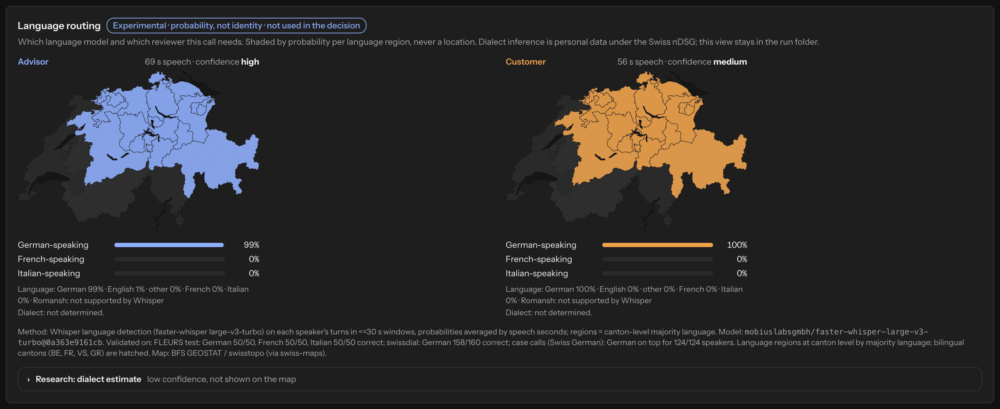
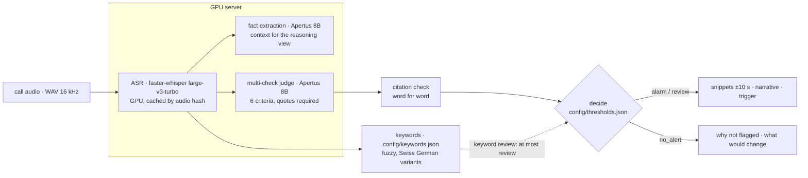
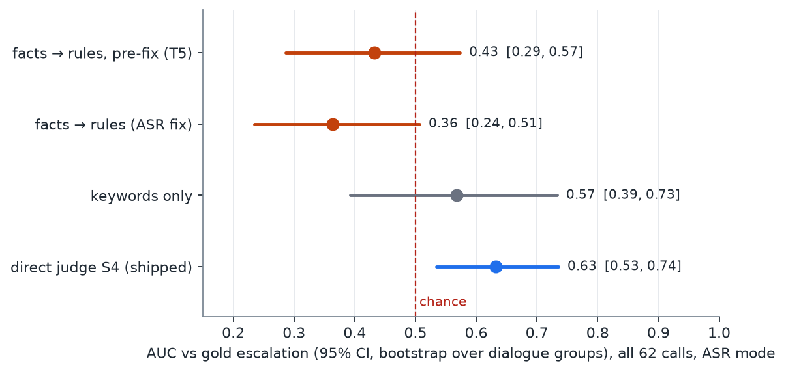
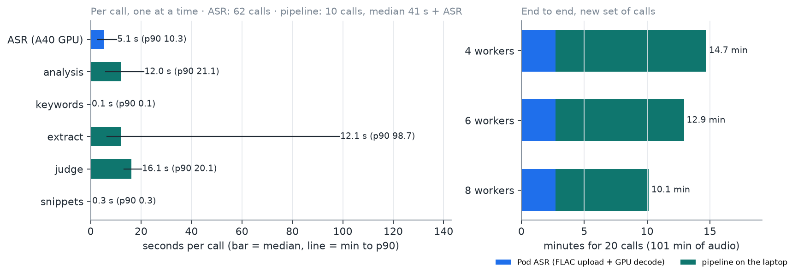

# SENTINEL

**Every bank call heard. Every alert proven to the second.**

<p align="center">
  
</p>

SENTINEL checks **every** Swiss German advisory call, not a sample. It transcribes the audio, runs one AI check per
kind of fraud, and decides **alarm**, **review** or **no alert**. Every alert comes with the exact words, the second
they were said and a clip to play, and every quote is checked word for word against the transcript before anyone sees
it. All of it runs on self-hosted open-weight models: no audio or text leaves the environment.

Built in 48 hours for the [Inventx × Outcept case](https://github.com/Outcept/inventx-case-study) at the sprintd
Innovation Sprint Zurich, October 2026.

## The four demo moments

| Moment (case brief) | Where in the app | What you see |
|---|---|---|
| 1. One call from audio to alert, with snippets | `/calls/call_041/processing` → `/calls/call_041` | every pipeline step replayed, then the alert: reason, risk against the alert line, the cited passages with a ±10 s clip each |
| 2. Change the threshold or keyword list, see the effect | `/settings/threshold`, `/settings/keywords` | the keyword-review switch and the alert line re-decide all 62 calls from cache in milliseconds; missed cases, false alarms and review load move; keyword hit counts update live |
| 3. A harmless call that still contains keywords | `/calls/call_040` | the alert's own insider words in six passages, but about public reports: **no alert**, with the judge's reason and what would change it |
| 4. Detection quality on the test set | `/quality` | 0 false alarms in 62 calls, the missed cases said out loud, AUC with its range, and the whole method ladder including what failed |

Press **Shift+D** anywhere for the guided 8-step demo (← / → to move; drafts reset between steps).

<picture>
  <source media="(prefers-color-scheme: dark)" srcset="docs/assets/readme/tour-dark.gif">
  
</picture>

| Alert with evidence | Threshold | Quality | Audio analysis: language map |
|---|---|---|---|
|  |  |  |  |

## Mandatory requirements

| Requirement (case brief) | Status | Where and how |
|---|---|---|
| Transcription of the Swiss German call | ✅ | faster-whisper large-v3-turbo, self-hosted, chosen by a GPU bake-off ([`pipeline/asr.py`](pipeline/asr.py)); **5.5 s per call** on one A40 ([PERFORMANCE.md](docs/PERFORMANCE.md)); it writes Standard German for Swiss German speech, WER 0.58–0.62 against the dialect scripts ([RESULTS.md](docs/RESULTS.md#asr)) |
| Several kinds of AI-based fraud checks | ✅ | six zero-shot checks, one per criterion (insider trading, credential sharing, third-party disclosure, documentation concealment, control evasion, payment card data), Apertus v1.5 8B; call risk = the highest check ([`pipeline/judge_multi.py`](pipeline/judge_multi.py)) |
| Suspicious passages as audio snippets, with timestamp and reason | ✅ | every alarm and review carries the cited segments, start and end seconds, the judge's reason and an ffmpeg clip ±10 s, ffprobe-checked ([`pipeline/snippets.py`](pipeline/snippets.py)); citations are validated word for word |
| An adjustable threshold | ✅ | alarm 0.70, review 0.20 and a keyword-review switch in [`config/thresholds.json`](config/thresholds.json); Settings previews every change on all calls before saving ([`pipeline/simulate.py`](pipeline/simulate.py)) |
| False alarms and missed cases, reported on the test set | ✅ | `/quality` and [RESULTS.md](docs/RESULTS.md): **0 false alarms, 21 of 34 escalations missed** on the 62 case calls; the hidden set runs through `scripts/run_test_set.sh`, which also writes the organisers' result files |
| No manual steps per call | ✅ | `./run.sh <folder>` or `scripts/run_test_set.sh <folder>` (one command: checks, GPU ASR, pipeline, export); live upload of a WAV in the web app |

## Stretch goals

| Goal (case brief) | Status | Where |
|---|---|---|
| Speaker separation | ✅ | pyannote 3.1 voices mapped to advisor / customer by Apertus: **87.3 %** of aligned words get the right role; display only ([`pipeline/diarize.py`](pipeline/diarize.py)) |
| Notifying the right person | 🟡 | every alarm becomes an Outcept trigger with a deep link to the passage, dry-run unless `TRIGGER_URL` is set ([`pipeline/trigger.py`](pipeline/trigger.py)); routing to a named person is in the [operating concept](docs/OPERATING.md#3-four-eyes-on-alarms) |
| Feedback and better thresholds | 🟡 | one-click verdicts on every call (correct, false alarm, missed, escalate); the suggestion engine ranks the smallest config change that fixes flagged cases ([`pipeline/suggest.py`](pipeline/suggest.py)), tested on a synthetic corpus only |
| Patterns across calls | 🟡 | `/patterns`: entities and repeated phrasing across all calls, plus grounded questions to the self-hosted model with validated citations; lexicon and n-gram heuristics, not a learned model |
| Operating concept | ✅ | [docs/OPERATING.md](docs/OPERATING.md): on-prem GPU, no egress, roles, four eyes on alarms, retention, audit log, model updates through the arena gate plus officer approval |
| Outcept trigger API with backlink | 🟡 | payload `{url, title, description}` with `url = <UI>/calls/<id>?t=<seconds>`, straight to the passage; built and tested against the contract, run as a dry run here |

✅ done and measured · 🟡 works, with the limit named · ⬜ not started

## Architecture

<p align="center">
  
</p>

**Perceive with AI, decide with checks you can read.** Whisper turns speech into timed text. The multi-check judge
reads the whole call once per criterion and must quote the lines behind every flag, and the quotes are validated. The
decision is a fixed rule over the judge's risk and the validated evidence: alarm at ≥ 0.70 with at least one valid
citation, review at ≥ 0.20, and an optional keyword review that can raise a call to review but never to alarm. A
failed stage or missing evidence ends as `review`, never as "all clear".

<details>
<summary>The pipeline as a diagram (text)</summary>



</details>

## Results

<p align="center">
  
</p>

All 62 case calls, from speech recognition to decision, zero-shot (no parameter tuned on these calls):

| | Multi-check judge (shipped) |
|---|---|
| Ranking quality, AUC [95 % CI] | **0.69** [0.58, 0.80] (0.50 = coin flip) |
| False alarms | **0** |
| Escalations found (alarm or review) | **13 of 34**: precision 1.00, recall 0.38 |
| Balanced accuracy | 0.69 (dev 0.69 · Testset_30 0.63 · holdout 0.83) |
| Sent to a person | 21 % of calls |

**The ladder, honestly.** Our first design, LLM fact extraction plus hand-written rules, ranked calls **worse than
chance** (AUC 0.36) and never beat "send everything to review". We report it because it shaped the final design. A
single judge prompt reached AUC 0.63 and found 9 of 34. One check per criterion lifted that to 0.69 and 13 of 34,
still with no false alarm. Keywords alone reach 0.57. Recall is the open problem, and the jury's hidden set is the
independent test. Full report, method, CIs and limitations: [docs/RESULTS.md](docs/RESULTS.md).



## Performance

| | measured 11 Oct 2026 ([PERFORMANCE.md](docs/PERFORMANCE.md)) |
|---|---|
| Transcription per call, one NVIDIA A40 | **5.5 s** (real-time factor **0.020**; calls average 4.7 min) |
| Transcription per call, MacBook Air M2 CPU | 62 s (RTF 0.22), the fallback without a GPU |
| Whole pipeline per call, one at a time | 41.5 s median, plus ASR |
| 20 new calls end to end, 8 in parallel | **10.1 min**, zero stage errors |



## Quick start

**Prerequisites:** Python 3.11, ffmpeg, Node.js (current LTS) for the web app, and for GPU work an SSH entry
`sentinel-pod` for the GPU server that runs Apertus via vLLM ([RUN_HIDDEN_SET.md](docs/RUN_HIDDEN_SET.md#prerequisites)).

```bash
python3.11 -m venv .venv && .venv/bin/pip install -r requirements-dev.txt -r requirements-asr.txt -r requirements-analysis.txt
```

Open the tunnel to the GPU server and leave it running:

```bash
scripts/pod_tunnel.sh
```

Run the pipeline over a folder of WAVs:

```bash
./run.sh /path/to/wavs --out runs/new/out --artifacts runs/new/artifacts --workers 8
```

Or the whole test-set flow in one command:

```bash
scripts/run_test_set.sh /path/to/audio_or_the_organisers_packet
```

`run_test_set.sh` checks the setup, decodes on the GPU, runs the pipeline, prints the timing and writes
`export/Ergebnisse.csv`, `Ergebnisse.jsonl` and `Laufprotokoll.json`, with an integrity check against the packet.

The web app on a finished run (read-only local mode, port 3004):

```bash
cd web && npm ci && NEXT_PUBLIC_DATA_MODE=api NEXT_PUBLIC_API_PREFIX=/run-api SENTINEL_RUN_DIR=~/Developer/sentinel-runs/mc_0656_final SENTINEL_ARTIFACTS_DIR=../artifacts npm run dev -- -p 3004
```

Then open <http://localhost:3004> and press **Shift+D** for the demo. Tests: `.venv/bin/python -m pytest` and
`cd web && npm run check`.

## Configuration without code

| What | File | In the app |
|---|---|---|
| How strict (tuning): alarm and review lines, keyword review on or off and its minimum passages | [`config/thresholds.json`](config/thresholds.json) | Settings → Threshold: presets, a draggable alert line, and the effect on every call (missed, false alarms, review load) before saving |
| What to look for (configuration): six keyword families with Swiss German variants | [`config/keywords.json`](config/keywords.json) | Settings → Keywords: add or remove a word, with live hit counts and the calls it would change |
| Which checks exist and how they combine | [`config/rules.yaml`](config/rules.yaml), [`config/strategy_defaults.json`](config/strategy_defaults.json) | Settings → Keywords → Checks (advanced) |
| Which language model may be used | [`config/providers.yaml`](config/providers.yaml) | none, on purpose: self-hosted by default, remote only for fictional data behind a gate |

A threshold or keyword edit re-decides from cached transcripts and AI answers, so the effect is instant. In the
read-only local mode the app previews but does not save; saving goes through the API.

## Trust and compliance

- **Self-hosted, open weights only.** Whisper and Apertus run on our own GPU and no cloud AI API is called. Remote
  providers are refused for anything but fictional data, before any network call ([`pipeline/llm.py`](pipeline/llm.py)).
- **Every alert proven.** The judge must quote the call; each quote is checked word for word against the cited
  segment, and an alarm needs at least one valid citation. Unsure → `review`; a failed stage → `review`, never silence.
- **Audit record.** Each call keeps its decision path, the judge's checks and citations, the thresholds and the exact
  model, prompt and rule versions, printable from the call page.
- **Model arena.** Six open models ran the same judge on all 62 calls and none measurably beats Apertus (every CI
  overlaps), so Apertus stays ([docs/ARENA.md](docs/ARENA.md), `/arena`).
- **Governed learning loop.** Officer verdicts feed suggested threshold changes, and a model or prompt change has to
  pass the arena and an officer's approval ([OPERATING.md](docs/OPERATING.md#6-model-and-configuration-updates-the-arena-gate-plus-officer-approval)).
- **Language routing, not profiling.** The map shows which language model and reviewer a call needs, as probabilities
  over regions and never a location. Dialect inference is personal data under the nDSG and never feeds a decision
  ([DIALECT.md](docs/DIALECT.md)).
- **Operating concept:** [docs/OPERATING.md](docs/OPERATING.md).

## Repository map

```
run.py, run.sh     one command over a folder of WAVs -> results.json, snippets, triggers
pipeline/          one module per stage (asr, keywords, extract, judge_multi, validate, decide, snippets, narrate,
                   trigger); schemas.py (output contract), evaluate.py (the only module that reads labels),
                   simulate.py, timing.py
config/            thresholds.json, keywords.json, rules.yaml, providers.yaml, dialect_regions.json, organiser_keywords.json
scripts/           run_test_set.sh, Pod ASR, benchmarks, exports, figures, language ID, data preparation
web/               Next.js app: alerts, call page, settings, quality, arena, patterns, demo mode
services/api/      FastAPI service (jobs, events, settings, feedback)
tests/             pytest suite
docs/              reports, runbooks and figures (index below)
data/, artifacts/  case data and run outputs: read-only or gitignored, never committed
```

| Doc | What it is |
|---|---|
| [RESULTS.md](docs/RESULTS.md) | the scientific report: method, every number with its CI, negative results, limitations |
| [PERFORMANCE.md](docs/PERFORMANCE.md) | transcription and pipeline times, worker counts, the one-command run |
| [RUN_HIDDEN_SET.md](docs/RUN_HIDDEN_SET.md) | runbook for a new set of calls (the jury's hidden set) |
| [OPERATING.md](docs/OPERATING.md) | operating concept for production in a secured environment |
| [ARENA.md](docs/ARENA.md) | model arena: six open models against Apertus on the same judge |
| [DIALECT.md](docs/DIALECT.md) | language routing map: method, validation, confounds, privacy |
| [PRODUCT.md](docs/PRODUCT.md) | every screen and the JSON field behind each element |
| [API.md](docs/API.md) | API contract: endpoints, events, settings, errors |
| [REFERENCE_NOTES.md](docs/REFERENCE_NOTES.md) | reference code the web app adapts, with licences |
| [CLAUDE.md](CLAUDE.md) | project rules: self-hosting, label isolation, output contract |

## Limitations and next steps

- **Recall is low**: 13 of 34 escalations found. The judge is cautious by design (no false alarm); the keyword-review
  switch and the review line trade more reviews for fewer misses, measured in Settings.
- **Small, synthetic data**: 62 calls in 24 dialogue groups with synthetic voices, so the CIs are wide. The hidden set
  is the real test.
- **ASR writes Standard German** for Swiss German speech (WER about 0.6 against the dialect scripts). The language
  model reads it fine, but quotes appear in Standard German.
- **Prototype operations**: one rented GPU for the hackathon. Production needs an on-prem or Swiss-region GPU, a
  container image, the four-eyes workflow and the append-only audit log of [OPERATING.md](docs/OPERATING.md).
- **Not yet run live**: a real POST to the Outcept trigger API, feedback-driven suggestions on real officer verdicts,
  and `entity_types` in the organisers' export.
- **Dialect is not determined**: one SwissDial speaker per dialect and synthetic case voices make it unmeasurable
  ([DIALECT.md](docs/DIALECT.md)).

## Team

| | |
|---|---|
| Peter | lead, ML pipeline, evaluation, web |
| Jules | API |
| Loyola | ASR bake-off, CI, infrastructure |
| Nik | design, web |
| Carl | Swiss German keywords |

No audio, case data, model weights or secrets are in git. The pipeline sees neutral call ids only, never a label, and
all calls are fictional. Licence: [LICENSE](LICENSE).
