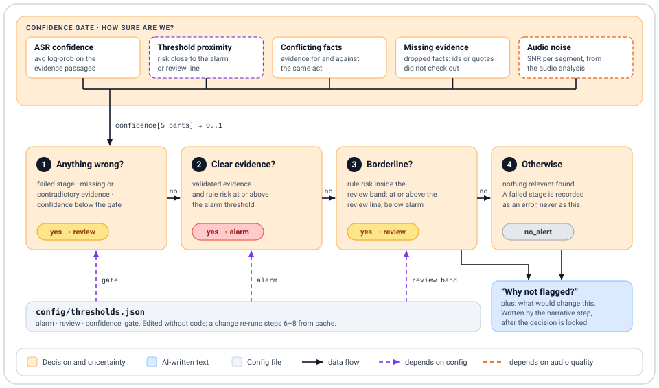
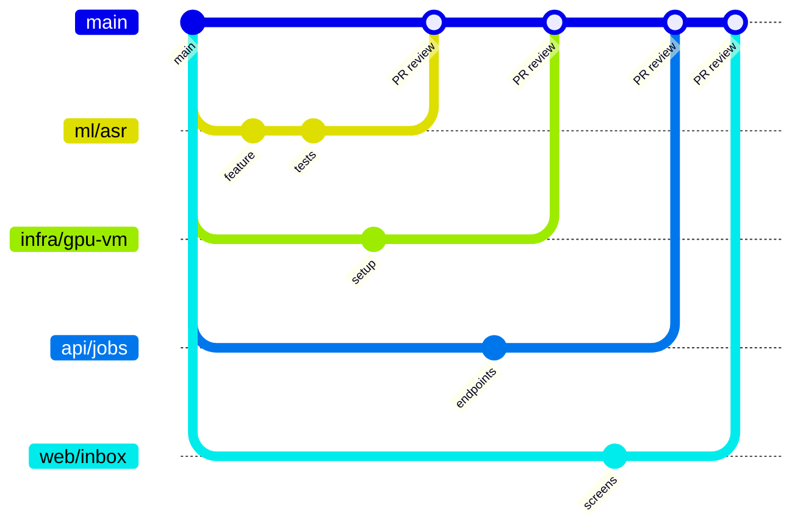

# SENTINEL

**Every bank call checked, not just samples.**

<p align="center">
  
</p>

**Figure 1. From a phone call to a decision with evidence.** AI reads the call, fixed rules decide, and every alert carries the exact audio that caused it.

Built for the Inventx / Outcept case at the sprintd Innovation Sprint Zurich (9–11 October 2026).

---

# Part 1 · For everyone

## The problem

Banks record client phone calls, but people can only listen to a small sample of them. Calls that break the rules, for example an advisor asking for a customer's password or acting on inside information, can slip through unnoticed. Checking every call by hand is impossible, and tools that send recordings to a cloud service are not acceptable for client conversations.

## What SENTINEL does

<p align="center">
  
</p>

**Figure 2. One call, five steps.** The example is invented; it shows what the compliance officer ends up seeing.

1. **Listen.** SENTINEL takes in the recording of a call, however noisy the line.
2. **Transcribe.** It turns the Swiss German speech into text, with a time stamp for every sentence.
3. **Understand.** It works out who asked for what and who revealed what, instead of just searching for suspicious words. A harmless call that merely contains the word "password" is not flagged.
4. **Decide.** Fixed, readable rules turn what was understood into one of three outcomes: **alarm**, **review** (a person should take a look) or **no alert**.
5. **Show the evidence.** Every alert comes with the exact quote, the time in the call and a short audio clip to play, so a compliance officer can check it in seconds.

## Why it can be trusted

- **Evidence for every alert.** The design discards any alert whose quote cannot be found in the call at the cited time, before anyone sees it.
- **It says when it is unsure.** If the audio is poor, the transcript is doubtful or the evidence conflicts, the call goes to **review**. The design never turns doubt into a confident alarm, and a technical failure is recorded as an error, not as "all clear".
- **Self-hosted by design.** The plan is to run all models on our own server in Switzerland, with no audio or transcript sent to any cloud AI service.
- **People stay in charge.** The AI reads and writes text. The decision comes from rules and thresholds that a compliance officer can read and change without programming.
- **Measured carefully.** Quality is to be reported on held-out calls, with its uncertainty, because the sample is small. No such results exist yet.

## Project status

*As of 10 October 2026.* ✅ done and tested · 🟡 works, but only with mock or invented data · 📐 specified, not yet built · ⬜ not started

| Milestone | What it delivers | Status |
|---|---|---|
| Data and splits | Neutral call IDs, labels kept apart from inference, dev / holdout / test split by dialogue | ✅ |
| Output contract and evaluation | Result schema, three metric conventions with confidence intervals, evidence validity check | ✅ |
| Baseline | One-prompt LLM judge over the reference transcript, the number the real pipeline must beat | 🟢 run on Apertus 8B as strategy S4 of the strategy lab ([`scripts/strategy_lab.py`](scripts/strategy_lab.py), 11 Oct 2026, dev + Testset_30): escalation F1 0.44 [0.23, 0.64], never alarms. The hybrid pipeline (S3) leads with 0.63 [0.47, 0.75], ahead of context-only 0.58, ensemble 0.54 and keywords-only 0.48; only S3 > S1 is separable at n = 48 ([`docs/RESULTS.md`](docs/RESULTS.md), top 3 in [`config/strategy_defaults.json`](config/strategy_defaults.json)) |
| Product and API specification | Every screen mapped to JSON fields, every endpoint and error state ([PRODUCT.md](docs/PRODUCT.md), [API.md](docs/API.md)) | ✅ |
| Mock data for the web app | Example calls, transcripts, traces, events and a quality report in [`fixtures/`](fixtures/README.md) | 🟡 all invented |
| LLM provider registry | One client for any OpenAI-compatible endpoint (our vLLM, Ollama, Infomaniak, OpenRouter) with a policy gate: remote providers only for fictional data and open-weight allowlisted models, measured TTFT / tokens per second / cost ([`config/providers.yaml`](config/providers.yaml), [`pipeline/llm.py`](pipeline/llm.py)) | 🟡 gate, metrics and streaming fallback unit-tested with fake responses; one live OpenRouter smoke run (10 Oct 2026, `qwen/qwen-2.5-72b-instruct`, one short German prompt: TTFT 521 ms, 1.26 s wall, 28 output tokens, 22.2 tok/s, 0.00002 USD) and all 6 allowlisted models found in the 458-model catalog; streaming fallback not yet run against a real vLLM; not yet used by fact extraction (not built) |
| Infrastructure | GPU server, vLLM, SSH tunnel | 🟡 builder Pod (Runpod A40, Montreal, fictional data only) serves two self-hosted models through one tunnel ([`scripts/pod_tunnel.sh`](scripts/pod_tunnel.sh)): Apertus v1.5 8B (`builder_pod`, laptop :8000, 0.45 of VRAM) and Qwen2.5-32B-Instruct-AWQ (`builder_pod_qwen`, Pod :8010 → laptop :8002, 0.50 of VRAM, weights on the container disk). Live smoke test on 11 Oct 2026, ~4.2k input / 400 output tokens: Apertus 34 tok/s decode, TTFT 1.2–1.9 s; Qwen 13–15 tok/s, TTFT 0.6 s warm / 6.4 s cold; 42.7 of 46 GB VRAM used, so stop Qwen before Whisper ASR. A Swiss-region server is still the target, not built |
| Transcription | Swiss German speech-to-text, model chosen by bake-off | ⬜ |
| Speaker roles, keywords, fact extraction | Who said what, keyword families, LLM facts | 🟡 fact extraction and evidence validator built and unit-tested with a fake client ([`pipeline/extract.py`](pipeline/extract.py), [`pipeline/validate.py`](pipeline/validate.py), `scripts/run_extract.py`). Model × prompt grid on dev + Testset_30 (48 calls, reference transcripts, untuned rules, 11 Oct 2026; [`docs/RESULTS.md`](docs/RESULTS.md)): Apertus v1.5 8B + prompt v2 wins with escalation F1 0.63 [0.47, 0.75] (dev 0.59, Testset_30 0.67), ahead of Apertus v1 0.58 and Qwen2.5-32B-AWQ v1/v2 0.42/0.30; zero failed calls (over-long windows are split and retried); 10 false alarms on gold no_alert are still open; speaker roles ⬜ |
| Evidence check, rules, confidence, decision | The deterministic core | 🟡 keywords, rules, confidence gate and decision built and tested on synthetic facts (`pipeline/decide.py`); the evidence validator and fact extraction are not built, nothing run on real data, all numbers are untuned placeholders |
| Narrative, audio snippets, trigger | Explanations, playable clips, call to the Outcept API | 🟡 built and unit-tested: template narrative (no LLM), ffmpeg snippets (±10 s, ffprobe-checked), trigger in dry-run by default; snippets and a real trigger POST not yet run on real ASR output |
| `run.sh` command line | `./run.sh <folder>` produces `out/results.json` and snippets | 🟡 frozen final run in ASR mode on all 62 calls (11 Oct 2026, `run.py --split all --workers 4`): zero stage errors, real snippets, every call fully explained (`scripts/check_explainability.py`). Escalation F1 0.43 dev / 0.35 Testset_30 (tuned on) and **0.00 on the unseen holdout** (0 of 6 escalations found, 0 false alarms, 5 harmless calls sent to review); see [`docs/RESULTS.md`](docs/RESULTS.md). Cold run on a fresh folder works with no manual step (~95 s per call on a laptop CPU) |
| Audio analysis | Waveform, spectrogram, quality score for the UI | 🟡 |
| What-if, feedback, suggestions | Simulate a config change over cached calls (flipped calls with reasons, officer workload), record officer verdicts, rank the smallest change that fixes flagged false alarms / misses without touching calls marked correct ([`simulate.py`](pipeline/simulate.py), [`suggest.py`](pipeline/suggest.py), [`feedback.py`](pipeline/feedback.py)) | 🟡 engine built and tested on a synthetic corpus only (no real traces or officer feedback yet); `GET`/`POST /feedback` built in the API (in memory in fixture mode); `/simulate`, `/suggestions` and `/audit` specified in [API.md](docs/API.md) but not built |
| API service | FastAPI, job queue, live events ([`services/api/`](services/api/README.md)) | 🟡 endpoints answer in fixture mode (MOCK data), with tests, incl. `/feedback`; no real mode yet (reading `out/` results), uploads, audio and `process_call()` not wired yet |
| Web app | Two-panel Overview (grouped call list + call panel with transcript excerpt and waveform player), call dashboard, Sensitivity, Keywords & checks, Detection quality ([`web/`](web/README.md)) | 🟡 all screens built and run in api mode against the API in fixture mode (MOCK data); not yet run against real pipeline results (the API has no real mode yet) |

## Team

| Who | Role |
|---|---|
| Peter | AI / ML and full stack |
| Loyola | Infrastructure and integration |
| Jules | Infrastructure and integration |
| Nik | UX and presentation |

---

# Part 2 · For developers

## Quickstart

Requires Python 3.11 and [uv](https://docs.astral.sh/uv/). The pipeline code so far uses only the standard library; `pytest` is the one dev dependency.

```bash
uv venv --python 3.11
source .venv/bin/activate
uv pip install -r requirements-dev.txt
```

Put the case data under `data/case/` and the organisers' 30 % package under `data/test30/` (read-only, never committed), then build the manifests and splits:

```bash
python scripts/prepare_data.py
```

Run the tests:

```bash
pytest
```

Run the baseline without a model (`--provider mock` uses keyword cues, **not** an LLM) and score it:

```bash
python scripts/baseline_direct.py --split dev --provider mock
python -m pipeline.evaluate --pred artifacts/predictions/baseline_direct_MOCK_dev.json --split dev
```

A real baseline run needs `LLM_BASE_URL` (and optionally `LLM_MODEL`) in `.env`, pointing at the vLLM server through the SSH tunnel on `127.0.0.1:8000`.

## Architecture

<p align="center">
  
</p>

**Figure 3. Target deployment: everything that touches a call stays inside the secured environment.** The laptop reaches it only through an SSH tunnel, and no cloud AI API is called, not even for a quick test.

<p align="center">
  
</p>

**Figure 4. Doubt is checked first, so an unsure call is meant to end as `review`, not as an alarm.** Thresholds come from `config/thresholds.json`, and the "why not flagged" text is written only after the decision is locked.

The full step-by-step design, output contract and evaluation rules are in [CLAUDE.md](CLAUDE.md).

## Repository layout

```
CLAUDE.md          project guide, hard rules, output contract
docs/              PRODUCT.md (screens → JSON fields), API.md (endpoints), assets/ (figures)
fixtures/          MOCK data for every contract (invented)
pipeline/          schemas.py, evaluate.py, llm.py, reference.py      (stage modules: planned)
scripts/           prepare_data.py, baseline_direct.py
tests/             pytest suite
data/              case data, read-only, gitignored
artifacts/         manifests, splits, cache, predictions, metrics, gitignored
web/               Next.js app (fixtures mode and api mode)
services/api/       FastAPI service (fixture mode so far)
config/ run.sh     planned, not created yet
```

## Documentation

- [CLAUDE.md](CLAUDE.md): rules, pipeline design, output contract, evaluation
- [docs/PRODUCT.md](docs/PRODUCT.md): what each screen shows and which JSON field feeds it
- [docs/API.md](docs/API.md): endpoints, events, settings, error shapes
- [fixtures/README.md](fixtures/README.md): the MOCK data and how to regenerate it
- [web/README.md](web/README.md): running the web app
- [docs/REFERENCE_NOTES.md](docs/REFERENCE_NOTES.md): which reference code the web app adapts, and what it drops

## Data policy

No audio, case data, model weights, `.env` files or secrets go into git (see `.gitignore`). The original dataset under `data/` is read-only. The pipeline reads only neutral call IDs from `artifacts/manifests/inference.json`; labels and original file names live in `evaluation.json` and are read only by `pipeline/evaluate.py`, after predictions exist. The test split is never used for tuning.

## Branching strategy

Work is split by area, with one long-lived branch (`main`) and short-lived topic branches. Each branch prefix has an owning area, changes reach `main` only through a reviewed pull request, and `main` should stay runnable.



| Prefix | Area |
|---|---|
| `ml/*` | Pipeline, models, evaluation |
| `infra/*` | Servers and deployment |
| `api/*` | Backend service |
| `web/*` | Frontend |
| `docs/*` | Documentation |
