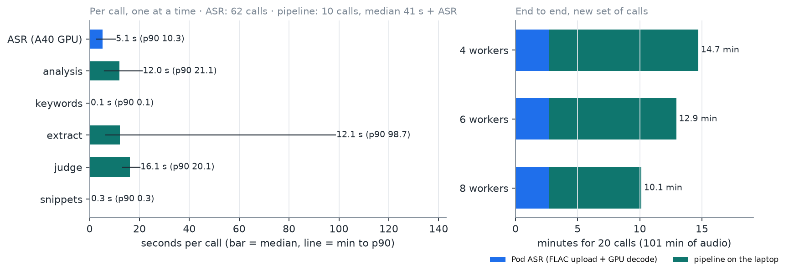

# Processing time

Measured on 11 Oct 2026 for the organisers' question "average transcription time per audio file", and to plan
the hidden test set. Every number below comes from `artifacts/metrics/timing.json` (local, gitignored like all artifacts)
(merged by [`scripts/bench_timing.py`](../scripts/bench_timing.py) from the raw files it lists under `sources`).



## In one paragraph

Transcription takes **5.5 s per call on one NVIDIA A40 GPU** (mean over all 62 case calls, median 5.1 s), for calls
that are **4.7 min long on average** (279 s): a real-time factor of **0.020**, about 50× faster than real time. On a
MacBook Air M2 CPU the same model takes **62 s per call** on a 6-file sample (RTF 0.22). The full pipeline (ASR,
audio analysis, LLM fact extraction, multi-check judge, decision, snippets) takes **41 s median / 68 s mean per call**
one at a time, plus the 5 s of GPU ASR. A new set of **20 calls (101 min of audio) runs end to end in 10.1 min with 8
workers** (2.7 calls per minute) with zero stage errors.

## Transcription (ASR)

faster-whisper large-v3-turbo (`mobiuslabsgmbh/faster-whisper-large-v3-turbo@0a363e9161cb`), the pipeline's own
decode settings (`pipeline.asr.DECODE`: German, beam 5, VAD, word timestamps). Real decode of every file, cache
bypassed, one file at a time; model load and one 10 s warm-up decode are timed separately and excluded
([`scripts/pod_bench_asr.py`](../scripts/pod_bench_asr.py)).

| | GPU: NVIDIA A40 (Runpod), float16 | CPU: MacBook Air M2 16 GB, int8 |
|---|---|---|
| files | all 62 case calls | 6-file sample spread over the length range |
| mean audio length | 279 s (4.7 min) | 286 s |
| **transcription time per file, mean** | **5.5 s** | **62.3 s** |
| median / p90 (nearest rank) / min / max | 5.1 / 10.3 / 2.8 / 11.3 s | 51.8 / 133.7 / 33.4 / 133.7 s (n = 6: p90 = the max) |
| real-time factor (overall) | **0.020** | **0.218** |
| model load (once) / warm-up | 1.9 s / 0.9 s | 2.7 s / 4.5 s |
| GPU memory | +2.6 GB next to the running Apertus server | n/a |

Raw files: `artifacts/metrics/pod_asr_bench_20261011_0912.json`, `artifacts/metrics/cpu_asr_bench_20261011_0913.json`.

## Pipeline stages (one call at a time)

10 dev calls, fresh LLM caches (real Apertus calls through the tunnel), GPU decodes copied in, `--workers 1`
(`run.py --timings`, raw: `sentinel-runs/bench_stages_p6/timings.json`). The ASR row is the GPU benchmark above;
in this run ASR was a cache read (0.55 s).

| stage | mean | median | p90 | max |
|---|---|---|---|---|
| ASR (A40 GPU) | 5.5 s | 5.1 s | 10.3 s | 11.3 s |
| audio analysis (laptop CPU) | 11.9 s | 12.0 s | 21.1 s | 21.4 s |
| keywords | 0.08 s | 0.09 s | 0.13 s | 0.14 s |
| fact extraction (Apertus 8B, whole call in windows) | 38.2 s | 12.1 s | 98.7 s | 141.0 s |
| multi-check judge (Apertus 8B, one check per criterion) | 16.6 s | 16.1 s | 20.1 s | 20.1 s |
| rules, confidence, decide, narrative | < 0.01 s | | | |
| snippets (2 calls with findings) | 0.32 s | 0.32 s | 0.34 s | 0.34 s |
| **whole call (without ASR)** | **67.6 s** | **41.5 s** | **138.9 s** | **183.4 s** |

Fact extraction dominates and varies most: it runs over the whole conversation in windows, so long, dense calls cost
more. 0 stage errors.

## A new set of calls end to end (rehearsal for the hidden set)

20 re-encoded copies of case calls under neutral names (`rec_01.wav` …, 101 min of audio, so no cache could help),
run exactly as [`RUN_HIDDEN_SET.md`](RUN_HIDDEN_SET.md) describes, each worker count in a fresh artifacts folder.

**Upload format.** The audio upload to the Pod was most of the ASR wall time. Lossless FLAC (same 16 kHz samples)
is 2.3× smaller and the decodes are identical (all 20 files: same segments, text and times):

| upload | size | upload | GPU decode (incl. ssh + model load) | download | Pod ASR total |
|---|---|---|---|---|---|
| WAV (per-file scp before, one tar stream now) | 185 MB | 86.6 s | 122.9 s | 4.4 s | 214.2 s |
| **FLAC** (default now) | **80 MB** | **30.5 s** | 127.6 s | 4.2 s | **163.9 s** |

**Workers.** Calls processed in parallel on the laptop against the shared Apertus server:

| workers | pipeline wall | calls / min | per call median (under load) | stage errors | **20 calls end to end** |
|---|---|---|---|---|---|
| 4 | 719 s | 1.67 | 96 s | 0 | 14.7 min |
| 6 | 613 s | 1.96 | 113 s | 0 | 12.9 min |
| **8** | **444 s** | **2.70** | 171 s | **0** | **10.1 min** |

All three runs produced the same decisions (2 alarm / 1 review / 17 no_alert). More workers keep the LLM server
busier (per-call times grow, total time falls). Order effect: the runs went 4 → 6 → 8 on the same audio and vLLM
caches prompt prefixes (34 % of all prompt tokens were cache hits since the server started), so the later runs may
have been helped by the earlier ones. A control (4 workers again, warm cache) was started but is **invalid**: the GPU
Pod went offline during it (10:30, 16 calls ended as review with "connection refused", which is the designed
behaviour). So the 8-worker gain is not yet separated from the cache effect; the order effect is a known caveat.

**Recommendation:** `--workers 8` (the default of `scripts/run_test_set.sh`): the fastest setting with zero stage
errors; use `--workers 6` if the shared LLM server is also serving the demo. Per 100 calls of the case length that
is about 37 min pipeline + about 14 min Pod ASR (estimate: the measured rates scaled linearly, not run).

## One command

```bash
scripts/run_test_set.sh <folder with audio | the organisers' packet folder>
```

Checks (venv, ffmpeg, tunnel + Apertus, ssh to the Pod, disk), converts any non-WAV / non-16 kHz-mono audio, GPU ASR
on the Pod with FLAC upload, the pipeline with 8 workers and `--timings`, a timing summary and the total time, a
quality summary if `--labels` is given, and the organisers' result files (`export/Ergebnisse.csv`,
`Ergebnisse.jsonl`, `Laufprotokoll.json`). If the Pod is unreachable, or its decodes do not match the pipeline's
model and cache keys, it stops rather than re-decoding on the CPU without saying so; `--cpu` runs the laptop ASR on purpose.

## How to reproduce

```bash
# GPU (on the Pod, from a copy of pipeline/ + scripts/pod_bench_asr.py + scripts/pod_asr_batch.py)
python scripts/pod_bench_asr.py /workspace/sentinel/artifacts/manifests/inference.json out.json --audio-root /workspace/sentinel
# CPU sample (laptop)
.venv/bin/python scripts/pod_bench_asr.py artifacts/manifests/inference.json cpu.json --device cpu --compute-type int8 \
  --ids call_049 call_050 call_026 call_034 call_052 call_061
# per-stage run, then merge + figure
.venv/bin/python scripts/bench_timing.py stages --scratch ~/Developer/sentinel-runs/bench_stages
.venv/bin/python scripts/bench_timing.py report --gpu out.json --cpu cpu.json --stages <timings.json> --rehearsal <timing_summary.json> ...
```

## Limits

- One GPU (A40) shared with the running Apertus server; one laptop (M2, 8 cores). Other hardware gives other times.
- The CPU number is a 6-file sample, not all 62.
- The pipeline-stage table is 10 dev calls; the rehearsal is 20 calls. Small samples: medians are more telling than
  means, and extraction time depends strongly on call length and content.
- "Time per call" is processing time after the recording exists, not a live (streaming) latency.
