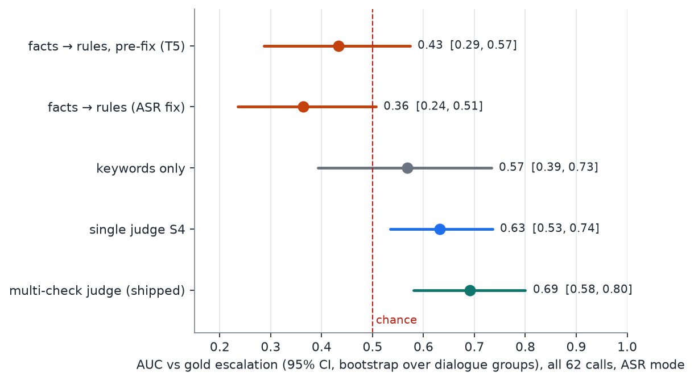
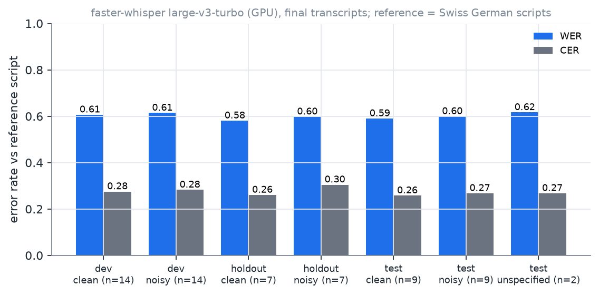
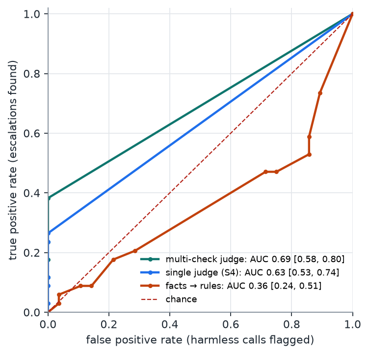
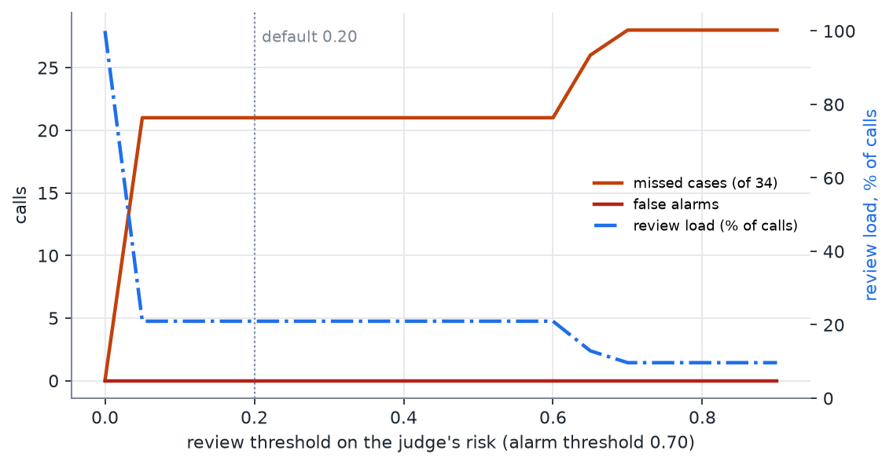

# SENTINEL results

SENTINEL listens to Swiss German bank calls and decides `alarm`, `review` or `no_alert`, with timestamped,
playable evidence for every flag. This page is the scientific report: what we measured, how, and what it means.
Every number was computed on 11 Oct 2026 from the runs and files named; nothing here is estimated.

## Summary



- **The shipped decision is a multi-check LLM judge on speech-recognition transcripts**: Apertus v1.5 8B, self-hosted,
  checks the whole call once per compliance criterion, names the criterion and cites the lines; every citation is
  checked against the transcript. On all 62 case calls it ranks better than chance (**AUC 0.69 [0.58, 0.80]**), raises
  **no false alarm**, sends **21 % of calls** to a person, and finds **13 of the 34 calls that need escalation**
  (precision 1.00, recall 0.38, balanced accuracy 0.69). It is zero-shot with **no tuned parameter**, so these numbers
  are effectively unseen; per split the balanced accuracy is 0.69 (dev), 0.63 (Testset_30), 0.83 (holdout). The
  single-prompt judge it replaced reached AUC 0.63 and found 9 of 34.
- **The negative result**: our first design, LLM fact extraction followed by hand-written rules, ranks calls *worse
  than chance* (AUC 0.36–0.43). Its earlier escalation F1 numbers never beat the trivial "send everything to review"
  baseline. We report it because it shaped the final design and because it is the honest answer to "does it work".
- **The adjustable threshold** acts on the judge's risk; one slider move or one keyword switch changes the number of
  hits immediately (re-decision from cache in under 30 ms for 62 calls).
- **Limits**: 62 calls in 24 dialogue groups; recall is low; WER against the Swiss German scripts is about 0.6 (the ASR writes
  Standard German). The jury's hidden set is the independent test.

## Setup

- **Data**: the Outcept case set, 62 calls (30 clean and 30 noisy recordings of the same scripts, plus 2 calls without
  a variant tag), in 24 dialogue groups. Gold labels: 25 alarm, 9 review, 28 no_alert (34 need escalation).
  Stufe 1–3 = difficulty.
- **Splits** (`artifacts/splits/dialogue_splits.json`, grouped by dialogue so clean and noisy twins never cross
  splits): dev 28 calls, Testset_30 20 calls (cleared by Outcept for tuning), holdout 14 calls. Until T5 the holdout
  was kept unseen and scored once (escalation F1 0.00, recorded below as the pre-fix result). From T5b on, everything
  is "tuned on all case data; independent test = the jury's hidden set", and anything tuned is reported in 3-fold
  cross-validation over the three splits.
- **Label isolation**: only `pipeline/evaluate.py` reads labels; the pipeline sees neutral ids (`call_017`) and never a
  file name or label.
- **Models, all self-hosted** on a rented A40 (Montreal) for the hackathon, reached through an SSH tunnel:
  faster-whisper large-v3-turbo (ASR, GPU float16), Apertus v1.5 8B (vLLM, temperature 0, strict JSON schema, cached
  by content hash). Qwen2.5-32B-AWQ was evaluated and not chosen. The production target is a Swiss-region or
  on-premise GPU.
- **Metrics**: three conventions (strict alarm, escalation = alarm or review, 3-class macro F1), balanced accuracy,
  AUC of the risk score against gold escalation; 95 % CIs by bootstrap over dialogue groups.

## ASR



faster-whisper large-v3-turbo stays the ASR model: in the GPU bake-off (Loyola, 10–11 Oct) the full large-v3 only
tied it on case WER at twice the VRAM, and the Swiss German fine-tune was slightly worse (that bake-off's raw numbers
are not in this repository). Against the Swiss German reference scripts, WER is 0.58–0.62 and CER 0.26–0.30 for every
split and both variants: most of that "error" is the model writing Standard German for Swiss German speech, which
the downstream LLM reads fine. Clean and noisy recordings come out the same. Post-decode re-segmentation at sentence
ends and pauses (T5b) changed little (3555 → 3974 segments): Whisper's segments were already sentence-sized.

## Fact extraction, v1 → v2 → v2-asr

Prompt v1 cited zero-stripped ids and produced few facts; v2 fixed the id format, capped citations at 3 adjacent
lines and asked for one fact per relevant utterance (reference transcripts, dev + Testset_30: escalation F1 0.58 →
0.63 under the then-untuned rules). On ASR transcripts the unknown speakers broke it: shown as "(unknown)", Apertus
returned no facts at all; with a neutral label and the ASR prompt `extract-v2-asr` (roles inferred per fact) facts per
call rose from 1.6 to 10.6. Apertus beat Qwen2.5-32B-AWQ on both prompts.

## The negative result: facts → rules has no skill



The risk score of the facts → rules decision ranks calls below chance in every variant we ran: AUC 0.43 (T5,
pre-fix), 0.36 [0.24, 0.51] after the ASR fix, 0.41 on reference scripts. Calibration cannot fix a ranking: the best
threshold reached a balanced accuracy of 0.51. And with 34 of 62 calls needing escalation, "everything to review"
scores escalation F1 0.71, above every escalation F1 we had reported for this design (0.47 at best).

Why, in one call: `call_002` is a textbook control-evasion case: the customer splits a 9000 payment into two
transfers of 4500 "so that the whole thing does not land at the approval desk". The extractor recorded no fact for
it and the call scored risk 0.0. At the same time, harmless calls in which a customer reads out digits scored 0.9 as
credential sharing. The case set is built so that harmless calls carry the same topics and keywords as violations:
facts that capture the topic do not capture the violation.

## The direct judge

First one prompt per call (`pipeline/judge.py`), then, shipped, one focused zero-shot check per criterion
(`pipeline/judge_multi.py`, call risk = the maximum over the six checks): the criteria, the decision scale, and
verbatim citations of at most 15 words with the line id; every citation goes through the same validator as the facts.
The judge decides; an alarm also needs a validated citation and confidence at the gate. Facts, rules and keyword hits
stay in every trace as the "why", and the snippets are cut from the judge's validated citations.

| method (all 62, ASR mode) | AUC [95% CI] | balanced accuracy | escalation P / R | review load | false alarms |
|---|---|---|---|---|---|
| everything to review | 0.50 | 0.50 | 0.55 / 1.00 | 100 % | 0 |
| keywords only | 0.57 [0.39, 0.73] | 0.51 (CV) | | | |
| facts → rules | 0.36 [0.24, 0.51] | 0.46 (CV) | | 5 % | 0 |
| single judge | 0.63 [0.53, 0.74] | 0.63 | 1.00 / 0.26 | 15 % | 0 |
| **multi-check judge (shipped)** | **0.69 [0.58, 0.80]** | **0.69** | **1.00 / 0.38** | **21 %** | **0** |
| judge + learned review conditions | = judge | 0.64 (CV) = judge alone | | | |

A learned recall layer (depth-3 tree over judge risk, mined n-grams, keyword hits and fact flags, mined and fitted
inside each CV fold) either sent 74 % of calls to review at balanced accuracy 0.53, or, held to ≤ 40 % review load,
added nothing. It is not shipped.

## The threshold



`config/thresholds.json`: alarm if the judge's risk ≥ 0.70 with a validated citation, review if ≥ 0.20 (for the
single judge these defaults reproduce its own verdicts on all 62 calls). With the multi-check judge: 0 false alarms,
21 missed of 34, 21 % review load at the defaults; raising the alarm/review cut to 0.70 halves the load (10 %) at 7
more missed cases; lowering the review threshold to 0 sends everything to a person. The keyword switch
(`keyword_review`) lets keyword hits alone raise a call to review, never to alarm: with at least 2 hit segments per
family it finds 4 more cases at 40 % review load. False alarms stay 0 along the whole curve.

## Limitations

- **n is small**: 62 calls in 24 dialogue groups; CIs are wide (AUC 0.53–0.74 for the judge).
- **Recall is low**: the judge finds 13 of the 34 calls that need escalation; it is precise, not thorough.
  A compliance team using it today would still sample the rest.
- **Everything ran on rented hardware outside Switzerland** with fictional case data only. Real customer data needs the
  self-hosted Swiss or on-premise deployment described in the architecture; no data ever went to a cloud LLM API.
- **No diarization**: speaker roles are inferred by the LLM from content.
- **Tuning on case data**: thresholds and prompts were developed on these 62 calls; the judge's verdict has no fitted
  parameter, but the prompt was written while looking at the case material. The jury's hidden set is the real test.
- **The bake-off raw numbers** (large-v3 vs turbo vs Swiss fine-tune) live in Loyola's notes, not in this repository.

---

# Detailed log (chronological, as measured during the night)

## Model and prompt choice (T2/T3, 11 Oct 2026)

Setup: reference transcripts (not ASR), full pipeline from fact extraction to decision with the **untuned placeholder**
rules and thresholds in `config/`, so absolute numbers are a lower bound for every row; the ranking compares like with like.
Tuning set = dev (28 calls) + Testset_30 (20 calls, cleared by Outcept for tuning) = 48 calls. Both models are
self-hosted on the builder Pod (A40) through `config/providers.yaml`; temperature 0, cached by content hash.
Gold distribution: 21 alarm, 7 review, 20 no_alert.

| model | prompt | esc F1 dev | esc F1 test30 | esc F1 mean | esc F1 all [95% CI] | alarm P | alarm R | macro F1 | false alarms on gold no_alert | failed calls | tokens in/out per call | s per call |
|---|---|---|---|---|---|---|---|---|---|---|---|---|
| **Apertus v1.5 8B** | **v2** | 0.59 | 0.67 | **0.63** | 0.63 [0.47, 0.75] | 0.45 | 0.43 | 0.29 | 10 (+6 review) | 0 | 3490 / 2054 | 106 |
| Apertus v1.5 8B | v1 | 0.42 | 0.75 | 0.59 | 0.58 [0.43, 0.71] | 0.26 | 0.24 | 0.21 | 12 (+6 review) | 0 | 1935 / 492 | 37 |
| Qwen2.5-32B-Instruct-AWQ | v1 | 0.43 | 0.40 | 0.41 | 0.42 [0.24, 0.58] | 0.33 | 0.05 | 0.12 | 2 (+12 review) | 0 | 2003 / 457 | 44 |
| Qwen2.5-32B-Instruct-AWQ | v2 | 0.17 | 0.43 | 0.30 | 0.30 [0.13, 0.45] | 0.00 | 0.00 | 0.11 | 6 (+6 review) | 0 | 3504 / 559 | 54 |

Reference point (not comparable run, dev only): Llama-3.3-70B with prompt v1 through OpenRouter (fictional data only)
reached escalation F1 0.76 on dev.

**Choice: Apertus v1.5 8B (`builder_pod`) with prompt v2.** It was already the default provider and prompt, so no config change.
- Ranking rule: equal-weight mean of dev and Testset_30 escalation F1 (v2 was iterated on dev, so Testset_30 counts at least
  as much as dev), ties → strict-alarm precision, then self-hosted Swiss Apertus. Apertus v2 leads on the mean (0.63) and on
  strict-alarm P/R. Apertus v1 is better on Testset_30 alone (0.75 vs 0.67), so the v1/v2 gap is not clearly significant
  (the CIs overlap heavily).
- Qwen-32B is more conservative under these rules: it labels many acts `hypothetical`/`warn` where Apertus says
  `request`/`disclose`, so few rules fire (strict-alarm recall 0.05 / 0.00). Its facts are valid (2–5 % dropped by the
  evidence validator). With rules tuned for it, it might do better; this grid does not show that.
- Apertus v2 per Stufe (escalation F1, 48 calls): Stufe 1 0.69, Stufe 2 0.57, Stufe 3 0.60.
- Known weakness: 10 false alarms on gold no_alert, 8 of them `credential_sharing` (harmless calls that mention passwords
  or codes, often in a warning). Next lever: counter-evidence handling in `config/rules.yaml` (warn/refuse acts lowering
  risk), calibrated in the final evaluation.

Infrastructure: zero failed calls in all four runs. Two Apertus v2 windows first hit the 3000-token answer limit (the model
lists one fact per utterance, up to 22 per window). `pipeline/extract.py` now splits such a window in half and retries;
windows that fit are unchanged, so cached runs stay valid.

Caveats: n = 48 with clean and noisy recordings of the same dialogue counted separately (they share a script in reference
mode), so the bootstrap CIs (2000 call resamples) are optimistic. Latency is per call with 2–4 calls in parallel and both
models sharing one A40, so it is an upper bound for a single stream.

Reproduce:
```bash
python scripts/run_extract.py --split tune --allow-test --provider builder_pod --prompt v2 --workers 4
python scripts/model_grid.py artifacts/predictions/extract_builder_pod_*_reference_tune*.json
```

## Detection strategies (T4, 11 Oct 2026)

Same tuning set (48 calls, reference transcripts, untuned rules), all LLM work by Apertus v1.5 8B on the builder Pod.
S2 and S3 re-decide the cached prompt-v2 facts; S4 is one prompt per call (`scripts/baseline_direct.py`).
Run `strategy_lab_t4` (`artifacts/bench/strategy_lab_t4/summary.json`), 2000 paired call resamples.

| id | strategy | esc F1 dev | esc F1 test30 | esc F1 all [95% CI] | alarm P | alarm R | macro F1 | false alarms on gold no_alert |
|---|---|---|---|---|---|---|---|---|
| S3 | hybrid: LLM facts + keyword hits through the rules (shipped) | 0.59 | 0.67 | **0.63** [0.47, 0.75] | 0.45 | 0.43 | 0.29 | 10 |
| S2 | context only: LLM facts, no keyword hits | 0.59 | 0.57 | 0.58 [0.42, 0.72] | 0.40 | 0.29 | 0.24 | 8 |
| S8 | ensemble: majority of S1, S3, S4; disagreement → review | 0.53 | 0.55 | 0.54 [0.36, 0.69] | 0.40 | 0.10 | 0.25 | 2 |
| S1 | keywords only (placeholder: alarm at hits in 3 segments of one family) | 0.43 | 0.55 | 0.48 [0.30, 0.64] | 0.44 | 0.19 | 0.23 | 4 |
| S4 | direct judge: one LLM prompt per call | 0.55 | 0.29 | 0.44 [0.23, 0.64] | n/a (no alarm) | 0.00 | 0.31 | 0 |

- **Default stays S3 (hybrid)**, written to `config/strategy_defaults.json` with S2 and S8 as the next two.
- Separable at P ≥ 0.95 (paired bootstrap on escalation F1): only **S3 > S1** (0.958). S3 vs S2, S8 and S4 are not
  separable at n = 48; the order among them is a tendency, not a result.
- Agreement (Cohen's κ): S2 and S3 agree on 90 % of calls (κ 0.84), so keyword hits change few decisions; LLM-fact
  strategies barely agree with S1 and S4 (κ ≤ 0.04). The ensemble follows S1 closely (κ 0.79) and trades recall for
  precision: only 2 false alarms on gold no_alert, but strict-alarm recall drops to 0.10.
- S4 never says `alarm` with this model: Apertus 8B as a one-prompt judge escalates only to review.
- Per Stufe (escalation F1): S3 0.69 / 0.57 / 0.60 for Stufe 1 / 2 / 3; S1 and S4 score 0.00 on Stufe 2.

```bash
python scripts/baseline_direct.py --split dev && python scripts/baseline_direct.py --split test --allow-test
python scripts/strategy_lab.py --facts artifacts/traces_extract/extract_builder_pod_apertus-8b_reference_tune_v2 \
    --direct artifacts/predictions/baseline_direct_builder-pod-apertus-8b_{dev,test}.json --run-id strategy_lab_t4
```

## Final system, ASR mode (T5, 11 Oct 2026)

Frozen configuration: faster-whisper large-v3-turbo (GPU decodes from the builder Pod), Apertus v1.5 8B + prompt v2,
hybrid strategy (S3), `config/rules.yaml` rules-v2, `config/thresholds.json` alarm 0.70 / review 0.30 / gate 0.50.
One run over all 62 calls (`run.py --split all`, run id `pipeline_asr_final`), real ffprobe-checked snippets,
zero stage errors. Holdout was scored exactly once, after the freeze. Reports: `artifacts/quality/final_report*.json`
(bootstrap over dialogue groups, 1000 resamples, 95 % CIs).

| set | n | strict alarm P / R | escalation P / R / F1 [95% CI] | macro F1 | false alarms on gold no_alert |
|---|---|---|---|---|---|
| dev (tuned on) | 28 | n/a / 0.00 | 0.50 / 0.38 / 0.43 [0.11, 0.69] | 0.14 | 0 (+6 review) |
| Testset_30 (tuned on) | 20 | 1.00 / 0.22 | 0.60 / 0.25 / 0.35 [0.00, 0.67] | 0.30 | 0 (+2 review) |
| **holdout (unseen)** | 14 | n/a / 0.00 | **0.00 / 0.00 / 0.00** | 0.12 | 0 (+5 review) |

What changed before the freeze (tuned on dev + Testset_30 only):
- **Unknown speakers.** ASR has no diarization, so every segment is `unknown`. Rendered as "(unknown)", Apertus
  answered `{"facts": []}` for every window (all 28 dev calls). `pipeline/extract.py` now shows them as "(speaker)";
  the model then attributes speakers from the content.
- **Counter-evidence (credential false alarms).** 8 of the 10 reference-mode false alarms were a customer reading out
  digits ("the last four are 4-2-4-2", or right after the advisor said "please don't tell me any number"). A customer
  credential disclosure is now review-level (0.6); the advisor disclosing it or a third-party recipient stays an alarm.
  Reference mode: false alarms 10 → 2, strict-alarm precision 0.45 → 0.62, escalation F1 unchanged (0.625), strict-alarm
  recall 0.43 → 0.24. An opt-in `prior_counter_speakers` (an earlier advisor warning discounts a customer disclosure)
  made things worse (escalation F1 0.58) and stays off.
- **Thresholds.** Grid over alarm 0.50–0.90, review 0.20–0.65, gate 0–0.7 (`scripts/calibrate.py`, objective
  mean(dev, test) escalation F1, ties → strict-alarm precision): review 0.40 → 0.30, others unchanged; tuning-set
  escalation F1 0.31 → 0.39.

**Honest reading.** The ASR-mode system is precise but nearly blind: it raised no false alarms on any split, but on the
unseen holdout it missed all 6 calls that needed escalation and sent 5 of 8 harmless calls to review. The gap to
reference transcripts (escalation F1 0.63 on the same tuning set) is the ASR stage: Whisper merges turns into long
undiarized segments and normalises Swiss German towards Standard German, and Apertus then finds about a tenth of the
facts (77 facts on 48 calls vs 673 with reference transcripts). Next levers, in order: speaker diarization
(`pipeline/diarize.py`, not built), segment splitting at pauses, and rules that do not depend on speaker roles.
n is small (14 unseen calls, 7 dialogues), so the CIs are wide.

## T5b: ASR-path fix (11 Oct 2026, 04:30–05:15)

From here on everything is **tuned on all case data (62 calls: dev + Testset_30 + holdout); the independent test
is the jury's hidden set.** The T5 holdout result above (escalation F1 0.00) stays recorded as the **pre-fix** result
(`artifacts/quality/final_report_prefix_holdout.json`).

Each step measured in ASR mode on all 62 calls (`scripts/measure_asr.py`, bootstrap over dialogue groups):

| step | facts / call | escalation P / R / F1 [95% CI] | strict alarm P / R | false alarms on gold no_alert | AUC risk vs escalation |
|---|---|---|---|---|---|
| pre-fix (T5 frozen system) | ≈ 1.6 | 0.41 / 0.26 / 0.32 [0.11, 0.51] | 1.00 / 0.08 | 0 (+13 review) | 0.43 |
| 1: re-segmentation at sentence ends / pauses ≥ 0.6 s / 25 words | 1.56 | 0.40 / 0.24 / 0.30 [0.13, 0.47] | 0.50 / 0.04 | 1 (+11 review) | 0.46 |
| 2: + ASR prompt `extract-v2-asr` (infer advisor/customer per fact) | 11.39 | 0.43 / 0.53 / 0.47 [0.31, 0.61] | 0.17 / 0.04 | 3 (+21 review) | 0.37 |
| 3: + ASR keyword floor (review band, never alarm) | best grid point: escalation balanced accuracy 0.51 with or without it | | | | |
| **shipped: steps 1 + 2, T5 thresholds** (run `asr_fix_final`) | 10.55 | 0.43 / 0.53 / 0.47 [0.31, 0.61] | 0.17 / 0.04 | 3 (+21 review) | 0.37 |

- Step 1 barely changes the transcript: Whisper segments are already sentence-sized (3555 → 3974 segments; only 312
  held more than one sentence). Kept because it makes evidence passages tighter and costs nothing.
- Step 2 is the real ASR fix for fact extraction: 7× more facts, escalation recall 0.24 → 0.53.
- Step 3 is in the config (`keyword_only_risk_asr`) but off: it did not help.
- Thresholds were left at the T5 values: no grid point (alarm 0.50–0.90 × review 0.20–0.65 × gate 0–0.7 × keyword
  floor) reached an escalation balanced accuracy meaningfully above chance (best 0.51).

### 3-fold cross-validation (the number to quote)

Thresholds (and, for the keyword-floor row, the floor) tuned on two splits with the `scripts/calibrate.py` grid and
objective (escalation F1, ties strict-alarm precision), scored on the third, rotated (`scripts/crossval.py`, re-decision
over cached traces, no LLM). Splits are dialogue-grouped. Escalation F1:

| config | dev | Testset_30 | holdout | **3-fold CV (mean, range)** | all 62 (tuned, in-sample) |
|---|---|---|---|---|---|
| pre-fix (T5, recorded; tuned on dev + Testset_30) | 0.43 (tuned on) | 0.35 (tuned on) | **0.00** (unseen) | n/a (traces overwritten) | 0.32 at T5 thresholds |
| + re-segmentation | 0.26 | 0.25 | 0.00 | 0.17 (0.00–0.26) | 0.30 |
| + extract-v2-asr | 0.38 | 0.71 | 0.44 | 0.51 (0.38–0.71) | 0.53 |
| + keyword floor | 0.56 | 0.71 | 0.44 | 0.57 (0.44–0.71) | 0.60 |
| **final (shipped: re-segmentation + extract-v2-asr, T5 thresholds, floor off)** | 0.38 | 0.71 | 0.44 | **0.51 (0.38–0.71)** | 0.53 |
| trivial: everything to review | 0.73 | 0.75 | 0.60 | 0.69 | 0.71 |

The keyword floor adds 0.06 CV escalation F1 only by sending more calls to review, which moves towards the trivial
"everything to review" row that every configuration stays below; it is not shipped. CV re-tunes thresholds per fold,
so the final row equals the extract-v2-asr row.

### The finding that matters: the facts → rules decision has no skill yet

Trivial baselines on all 62 calls (34 of them need escalation): "everything to review" scores escalation F1 **0.71**
(macro F1 0.09); "everything no_alert" scores macro F1 0.21. Every escalation F1 reported on this page so far,
including reference mode (0.63 on dev + Testset_30, where flag-all scores 0.74), is **below the flag-all baseline**.
The risk score ranks calls worse than chance: AUC against gold escalation is 0.37–0.46 in ASR mode and 0.41 for the
shipped hybrid on reference transcripts. Only the one-prompt direct judge (S4, reference) is above chance: AUC 0.64.

Why, from the calls: the extractor misses clear violations and fires on harmless calls. `call_002` (the customer
splits a 9000 payment into 2 × 4500 "so the whole thing does not land at the approval desk") gets risk 0.0, while
harmless calls where a customer reads out digits get 0.9. The case data is built so that harmless calls contain the
same topics and keywords as violations; facts that capture the topic (credentials mentioned, client data asked for)
do not capture the violation.

Next: make the direct judge the decision on ASR transcripts and keep the facts as evidence and explanation (being
measured in a follow-up branch before the freeze), and per-criterion fact types for the violation itself
(e.g. "split to avoid approval"), not the topic.

## T5b-2: the direct judge decides (11 Oct 2026, 05:00–05:10)

Decision: Peter, after the finding above. The one-prompt direct judge (S4, `pipeline/judge.py`, prompt `judge-asr-v1`)
reads the whole ASR transcript (roles unknown, inferred from content), returns verdict, criterion, risk and
verbatim citations; every citation runs through the same evidence validator as the facts. **The verdict decides**
(`config/thresholds.json` `decision_source: "direct_judge"`; `"rules"` restores facts → rules). An alarm needs at
least one validated citation and confidence at the gate, otherwise it is a review, never an alarm. Facts, rules and
the confidence breakdown stay in every trace as the "why"; snippets are cut from the judge's validated citations.
Judge answers are kept in `<out>/judge/<call_id>.json`.

All 62 calls, ASR mode (`scripts/judge_eval.py`). AUC vs gold escalation with a dialogue-group bootstrap CI;
balanced accuracy of an escalation threshold chosen by 3-fold CV (tuned on two splits, scored on the third):

| scorer | AUC [95% CI] | AUC dev / Testset_30 / holdout | 3-fold CV balanced accuracy (mean, range) |
|---|---|---|---|
| **S4 direct judge (risk)** | **0.63 [0.53, 0.74]** | 0.66 / 0.58 / 0.67 | **0.58 (0.50–0.67)** |
| facts → rules (risk) | 0.36 [0.24, 0.51] | 0.24 / 0.53 / 0.45 | 0.46 (0.38–0.50) |
| keywords only (hit segments per family) | 0.57 [0.39, 0.73] | 0.60 / 0.50 / 0.56 | 0.51 (0.48–0.54) |
| flag-all / flag-none | 0.50 | 0.50 | 0.50 |

Gate (set before measuring): ship S4 only if its AUC lower bound is above 0.5 or it clearly beats every baseline on
CV balanced accuracy. Both hold. Citations: 27 of 29 validated; every flagged call has at least one valid citation.

The shipped decision is the judge's own verdict, which has **no tuned parameter**, so each split is scored
out-of-sample (the CV threshold on its risk score reduces to "risk > 0", the same calls):

| set | n | balanced accuracy | escalation P / R / F1 | strict alarm P / R | false alarms on gold no_alert |
|---|---|---|---|---|---|
| dev | 28 | 0.66 | 1.00 / 0.31 / 0.48 | n/a / 0.00 | 0 |
| Testset_30 | 20 | 0.58 | 1.00 / 0.17 / 0.29 | n/a / 0.00 | 0 |
| holdout | 14 | 0.67 | 1.00 / 0.33 / 0.50 | 1.00 / 0.25 | 0 |
| **all 62** | 62 | **0.63** | **1.00 / 0.26 / 0.42 [0.14, 0.65]** | 1.00 / 0.04 | **0** |

Run `asr_judge_final` (`~/Developer/sentinel-runs/asr_judge_0507_final/`): 1 alarm (call_041, insider trading),
8 reviews, 53 no_alert; zero stage errors; every call fully explained. `artifacts/quality/final_report.json` is this
run (split "all", in-sample label kept although the verdict has no tuned parameter); the facts → rules fallback is
`final_report_facts_rules.json`; the pre-fix holdout result is `final_report_prefix_holdout.json`.

**Honest reading.** The judge is the first decision on this page that ranks better than chance and it never raised a
false alarm or sent a harmless call to review on these 62 calls. It is conservative: it finds about a quarter of the
calls that need escalation (9 of 34). Its escalation F1 (0.42) is still below the flag-all baseline (0.71); what it
offers over flag-all is precision 1.00 at a workload of 9 calls instead of 62. Next levers: recall (a second pass on
calls the facts flag but the judge clears; criterion-specific prompts), and n: 62 calls, 24 dialogue groups.

## The ladder (headline for the pitch)

| step | what decides | AUC vs gold escalation [95% CI] | balanced accuracy | escalation P / R | review load | false alarms |
|---|---|---|---|---|---|---|
| pre-fix (T5, holdout unseen) | facts → rules, ASR, no roles | 0.43 | holdout esc F1 **0.00** | holdout 0.00 / 0.00 | — | 0 |
| T5b facts → rules (re-segmentation + extract-v2-asr) | facts → rules | 0.36 [0.24, 0.51] | 3-fold CV 0.46 | OOF 0.00 / 0.00 at its CV threshold | 5 % | 0 |
| **S4 direct judge (shipped)** | judge verdict + validated citation | **0.63 [0.53, 0.74]** | **0.63** (dev 0.66, test30 0.58, holdout 0.67) | **1.00 / 0.26** | **15 %** | **0** |
| S4 + learned review conditions | judge + depth-3 tree | = S4 (cap binds) | 3-fold CV 0.64 = S4 alone; uncapped 0.53 at 74 % load | | | |
| everything to review (trivial) | — | 0.50 | 0.50 | 0.55 / 1.00 | 100 % | 0 |

**The S4 verdict has no tuned parameter** (no threshold, no rule weight was fitted on these calls; the prompt and
criteria were written before this run), so its numbers on all 62 calls are effectively unseen; the per-split
numbers agree (0.58–0.67). Everything else on this page that was tuned is labelled in-sample or reported in CV.

### Conditions after AI (recall layer, not shipped)

Design (Peter): alarm stays the S4 verdict with a validated citation; a learned layer may send more calls to REVIEW
from the S4 risk, mined n-grams, keyword hits and fact flags, with counter-evidence pushing towards no_alert. Mined
by log-odds with an informative Dirichlet prior over unigrams and bigrams present in >= 2 dialogue groups
(call-level, from ASR transcripts: the gold evidence windows point at reference-script turns, which ASR text does not
match), fitted as a depth-3 tree; mining and fitting inside each of the 3 folds (`scripts/learn_conditions.py`,
branch `ml/conditions`, not merged). Ship rule set before measuring: beat S4 alone on CV balanced accuracy with
<= 40 % review load. Result: uncapped, CV balanced accuracy 0.53 at 74 % review load (recall 0.76, precision 0.57);
with the cap enforced inside each fold the chosen cut adds no review, i.e. exactly S4 alone (0.64). It fails the rule,
so S4 alone ships. Per-method AUC with CIs and per-fold CV precision / recall: `artifacts/metrics/crossval.json`
(`methods`), `artifacts/metrics/conditions_cv.json`.

## Adjustable threshold and keyword list on top of the judge (11 Oct 2026, 06:00)

The brief requires an adjustable threshold, and demo moment 2 is one change to the threshold or the keyword list with
a visible effect. With `decision_source: direct_judge` the existing `alarm` / `review` thresholds now act on the
cached judge risk (`decide.judge_decide`): alarm if risk >= alarm AND >= 1 validated citation AND confidence >= gate;
review if risk >= review; otherwise no_alert. `keyword_review` (`{"enabled", "min_segments"}` in
`config/thresholds.json`, off by default) lets keyword hits alone raise a call to review, never to alarm; editing
`config/keywords.json` changes the hits without any LLM re-run. Defaults alarm 0.70 / review 0.20 reproduce the S4
verdicts: **0 of 62 calls differ**. `pipeline.simulate` re-decides all 62 calls from cache in **27 ms**.

In-sample curve on all 62 calls (`scripts/threshold_curve.py` → `artifacts/metrics/threshold_curve.json`; nothing was
tuned on these numbers; false alarms = gold no_alert decided alarm, missed = gold alarm/review decided no_alert):

| setting | false alarms | missed cases (of 34) | review load |
|---|---|---|---|
| review 0.00 (everything to a person) | 0 | 0 | 100 % |
| **review 0.20 (default)** | **0** | **25** | **15 %** |
| review 0.40 | 0 | 30 | 6 % |
| review 0.70 | 0 | 33 | 2 % |
| default + keyword review, min 4 segments | 0 | 25 | 18 % |
| default + keyword review, min 2 segments | 0 | 20 | 35 % |
| default + keyword review, min 1 segment | 0 | 17 | 40 % |
